# Summarize and analyze your observability data
Create an interactive dashboard to analyze AI model performance and OpenShift cluster metrics using Prometheus.

## Table of Contents

1. [Detailed description](#detailed-description)
   - [The Challenge](#the-challenge)
   - [Our Solution](#our-solution)
   - [Features](#features)
   - [Current Manual Process](#current-manual-process)
   - [Our Solution Stack](#our-solution-stack)
   - [Architecture diagrams](#architecture-diagrams)
2. [Requirements](#requirements)
   - [Minimum hardware requirements](#minimum-hardware-requirements)
   - [Minimum software requirements](#minimum-software-requirements)
   - [Required user permissions](#required-user-permissions)
3. [Deploy](#deploy)
   - [Install via Helm](#install-via-helm)
   - [Access control](#access-control)
   - [MCP server route (disabled by default)](#mcp-server-route-disabled-by-default)
   - [Deprecated: Operator and OpenShift Console plugin](#deprecated-operator-and-openshift-console-plugin)
   - [Quick Start - Local Development](#quick-start---local-development)
   - [Usage](#usage)
     - [Use a model deployed in the same cluster](#use-a-model-deployed-in-the-same-cluster)
   - [Configuration](#configuration)
     - [Model as a Service (MaaS) Setup](#model-as-a-service-maas-setup)
     - [DEV Mode Workflow](#dev-mode-workflow)
     - [Per-Model API Key Configuration](#per-model-api-key-configuration)
4. [References](#references)
5. [Tags](#tags)

## Detailed description

The OpenShift AI Observability Summarizer turns OpenShift + OpenShift AI observability signals into **plain-English, actionable insights**. Instead of stitching together dashboards and raw metrics, teams can quickly understand performance, cost drivers, and operational risks across AI workloads and the platform that runs them.

### The Challenge

AI platform and SRE teams routinely need to answer questions like:

- “Is my model latency increasing? What changed?”
- “Are GPUs saturated or underutilized?”
- “Which namespace/workload is causing resource pressure?”
- “Do logs/traces correlate with the metric spike?”

Today, these answers often require jumping between tools, writing queries, correlating signals across systems, and then producing a shareable narrative for stakeholders.

### Our Solution

Provide a **metrics-aware AI summarization layer** on top of OpenShift observability:

- Curated + dynamically validated **metrics catalog** (OpenShift + GPU) used for accurate query selection
- Natural-language **Chat with Prometheus** that generates queries and explains results
- **Dashboards** for OpenShift fleet metrics, vLLM metrics, and hardware accelerators
- **Report generation** (HTML/PDF/Markdown) for sharing
- Optional alerting integrations (Slack notifications) when enabled

### Features

- **Console-native experience**: Works where platform teams already operate—inside the OpenShift Console.
- **Faster time-to-answer**: Turn “what changed?” questions into clear, structured summaries in minutes.
- **Fleet + namespace insights**: Move from cluster-wide trends to namespace-level signals without context switching.
- **GPU & model visibility**: Understand accelerator utilization and model-serving performance using the same workflow.
- **Explainable outputs**: Summaries come with supporting details so engineers can validate conclusions quickly.
- **Shareable reporting**: Export clean HTML/PDF/Markdown reports for stakeholders and incident reviews.

### Current Manual Process

Without this project, teams typically:

- Manually browse dashboards and write queries
- Manually identify the “right” metrics among thousands of candidates
- Copy/paste charts and raw values into a document
- Correlate symptoms across:
  - metrics (Prometheus/Thanos)
  - GPU telemetry (DCGM exporter)
  - traces (Tempo)
  - logs (Loki)
- Recreate the same analysis for each incident, model rollout, or performance regression

### Our Solution Stack

**Data sources**

- **Prometheus / Thanos**: OpenShift and workload metrics
- **vLLM**: model-serving metrics (when vLLM is used)
- **DCGM exporter** (optional): GPU metrics (temperature, power, utilization, memory)

**Observability add-ons (optional / stack-managed)**

- **OpenTelemetry Collector**: collects traces and enables auto-instrumentation flows
- **Tempo**: trace storage/query (integrated into OpenShift Console via UI plugin)
- **Loki**: log aggregation/query (integrated into OpenShift Console via UI plugin)
- **aws-compatible-storage (S4)**: S3-compatible object storage for traces and logs, deployed in `ai-observability`

**Application components**

- **MCP server**: metrics analysis, report generation, and AI tool-calling surface
- **LLM runtime**:
  - Local model deployment by default (or connect to an existing model via `LLM_URL`)
  - External AI providers: OpenAI, Anthropic, Google, Meta, Model as a Service (MaaS)
- **UI**: standalone React UI, served on its own Route and protected by OpenShift sign-in

### Architecture diagrams

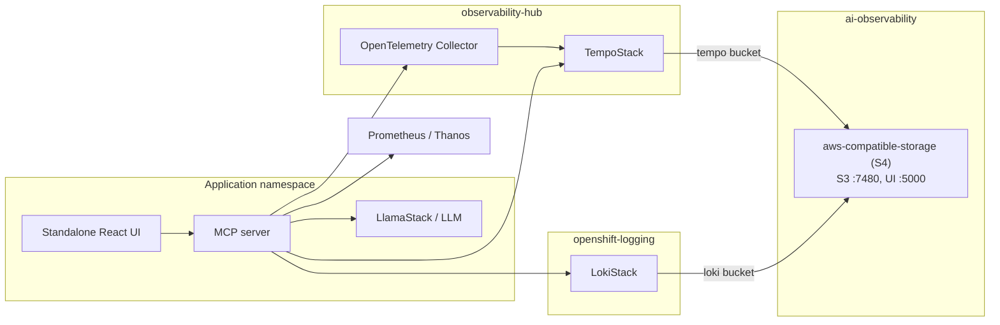

S4 uses a 10Gi PVC. The [shared aws-compatible-storage chart](https://github.com/rh-ai-quickstart/ai-architecture-charts/tree/main/aws-compatible-storage) packages the [upstream S4 runtime](https://github.com/rh-aiservices-bu/s4). The parent chart's regular boto3 Job creates the `tempo` and `loki` buckets and checks a temporary S3 write/read/delete in each. The S3 API stays inside the cluster at `http://s4.ai-observability.svc.cluster.local:7480`. The credentials Secret is `s4-credentials`; Tempo and Loki use mirrored Secrets in their namespaces. A Supervisor ConfigMap raises RGW's inherited file-descriptor limit to 65536 for the pinned S4 0.3.2 image.

This quickstart keeps the S4 Web UI Route **disabled by default** because its values include demo UI credentials. Before enabling it, set `S4_UI_USERNAME` and `S4_UI_PASSWORD` to unique values from a protected source, then run `make S4_UI_ROUTE_ENABLED=true install-s4`. For an operator or umbrella install, override `aws-compatible-storage.auth.username` and `aws-compatible-storage.auth.password` and set `aws-compatible-storage.route.enabled=true` in the deployment values. Keep the S3 API Route disabled. Do not commit real credentials to Git.

The Make and operator/umbrella install paths manage that Supervisor ConfigMap differently. Use one install path per namespace; migrate the existing release before switching paths. Loki also has its own WAL PVC, whose capacity depends on log volume and is separate from the S4 PVC.

#### Simple flow

1. **Open the AI Observability web UI** and sign in with your OpenShift account.
2. **Choose your analysis context** (cluster, namespace, or model view and a time range), or **ask a question** using the chat interface.
3. The platform **gathers the relevant observability signals** from your environment, covering both the current state and how it has changed over time.
4. It **synthesizes those signals into actionable insights**, highlighting what appears healthy or unhealthy, the most likely contributors, and recommended next checks.
5. **Share outcomes easily** by exporting the findings as a report when needed.

## Requirements

### Minimum hardware requirements

- **CPU**: 4 cores (8 recommended)
- **Memory**: 8 GiB RAM (16 GiB recommended)
- **Storage**: 20 GiB (50 GiB recommended)
- **GPU**: optional (recommended for DCGM + model workloads)

### Minimum software requirements

- **OpenShift**: 4.18.33+
- **OpenShift AI**: 2.16.2+
- **CLI tools**:
  - `oc`
  - `helm` v3.x
  - `yq`
  - `jq` (used by Makefile flows)

### Required user permissions

- **Installing**: cluster-admin (or equivalent privileges for installing cluster-wide observability components and required RBAC).
- **Using the UI**: by default, only users who can list all namespaces can sign in. See [Access control](#access-control).

## Deploy

### Install via Helm

The quickstart is installed with `make` and Helm. It deploys the standalone React UI as the web interface.

#### Quick Start - OpenShift Deployment

```bash
make install NAMESPACE=your-namespace
```

On an existing installation, this also upgrades the Tempo and Loki Helm releases to reference their S4 credential Secrets. The new buckets start empty: this command does **not** copy historical traces or logs from MinIO. Decide whether that history must be retained or copied, verify new ingestion and queries against S4, and keep the old MinIO release and PVC until that decision is complete.

**Want to install with existing LLMs?**

- **No Hugging Face / no local model download** (use an already-running model endpoint):

```bash
make install NAMESPACE=your-namespace LLM_URL=http://your-llm-endpoint
```

You can pass a complete HTTPS `/v1` endpoint as `LLM_URL`. For a protected
endpoint, export `LLM_API_TOKEN` before running `make install`; LlamaStack reads
it from the `llama-stack-env` Secret through a config placeholder.

**Access**

The UI is served on its own Route, `aiobs-react-ui`, and you sign in with your OpenShift account:

```bash
oc get route aiobs-react-ui -n your-namespace -o jsonpath='{.spec.host}'
```

Open `https://<host>` in a browser. You can also find the route in the OpenShift Console under **Networking → Routes**.

**Upgrading from the console plugin**

Earlier versions installed an OpenShift Console plugin. It is deprecated and is no longer installed. If it is still present, remove it:

```bash
make uninstall-console-plugin NAMESPACE=your-namespace
```

**Optional console menus**

- Traces menu: `make enable-tracing-ui`
- Logs menu: `make enable-logging-ui`

#### Quick Start - Local Development

Use the local dev helper to port-forward dependencies and run local components.

```bash
uv sync
./scripts/local-dev.sh -n your-namespace
```

#### Usage

#### Enable AI Assistance

Navigate to settings and configure a model:

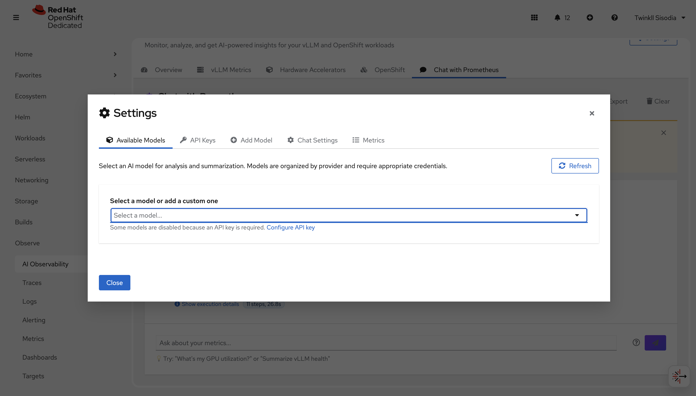

You can either set an `API_KEY` or add a custom model. Supported providers include OpenAI, Gemini, Anthropic, Meta, and Model as a Service (MaaS).

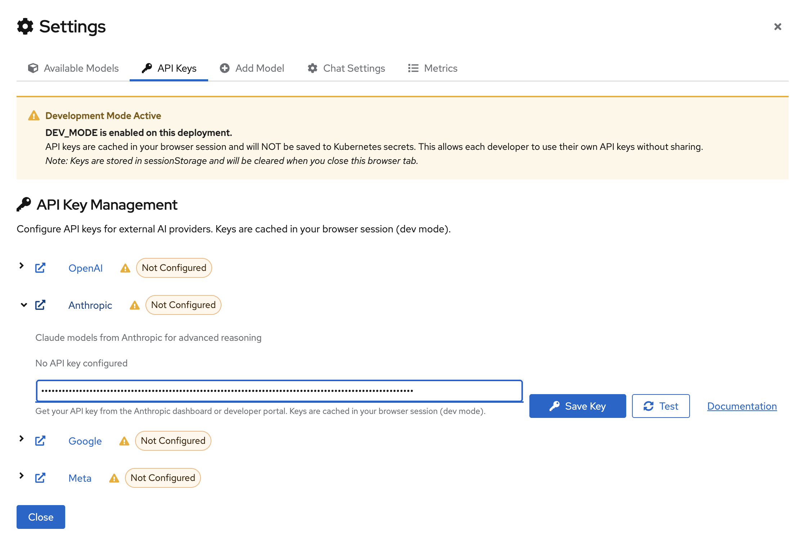

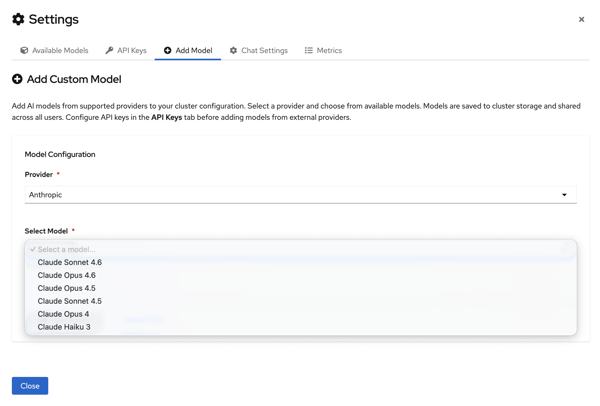

Once the model configuration is set, select your model from the dropdown:

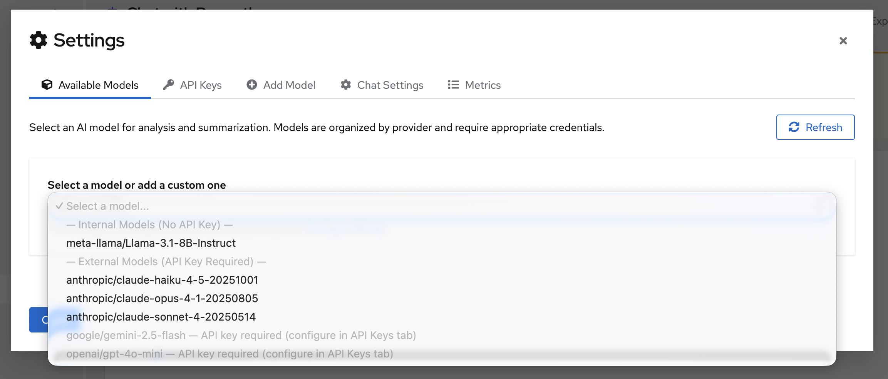

> **For detailed setup instructions**, see the [Configuration](#configuration) section below, which covers MAAS setup, DEV mode workflow, and per-model API key configuration.

##### Use a model deployed in the same cluster

The UI does not discover models running elsewhere in the cluster, such as models deployed with OpenShift AI in another project. To use one, add it as a Model as a Service (MaaS) model:

1. Click **Settings** in the **Overview** tab of the UI.
2. Click **Add Model**.
3. Select **Model as a Service (MaaS)**.
4. Enter the model resource name, for example `granite`.
5. Enter the API key.
6. Enter the model's external endpoint **followed by `/v1`**, for example `https://granite-granite-test.apps.<cluster-domain>/v1`.

You can find the model name, API key (the model's authentication token), and external endpoint in the OpenShift AI dashboard, in the model's deployment details. The model must have an external route enabled. The API key is stored in a Kubernetes Secret in the quickstart's namespace.

> **Note:** The OpenShift AI dashboard shows the external endpoint without `/v1`. If you enter it without `/v1`, the model is saved, but chat and summaries fail with `Error code: 404 - {'detail': 'Not Found'}`. To fix an existing entry, delete the model in **Settings** and add it again with `/v1`.

#### Using the UI

Open the UI route (see [Access](#quick-start---openshift-deployment)) and sign in with your OpenShift account.

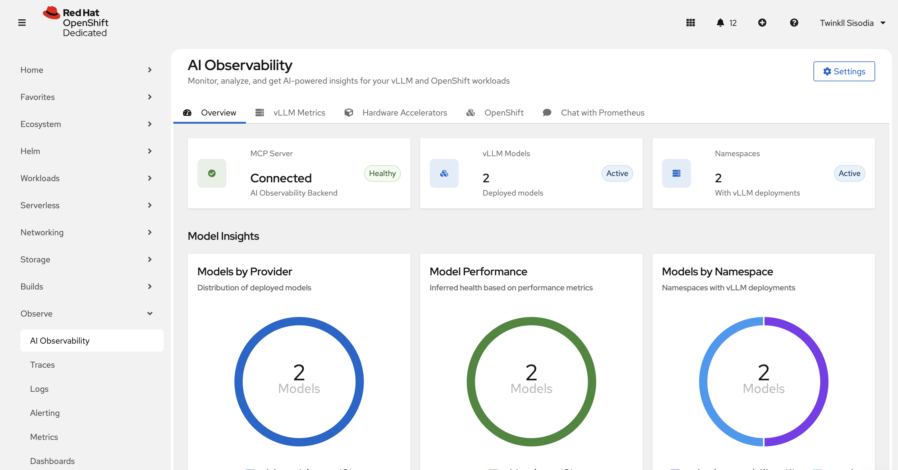

##### vLLM metrics

Use this page to understand model-serving performance when vLLM metrics are present.

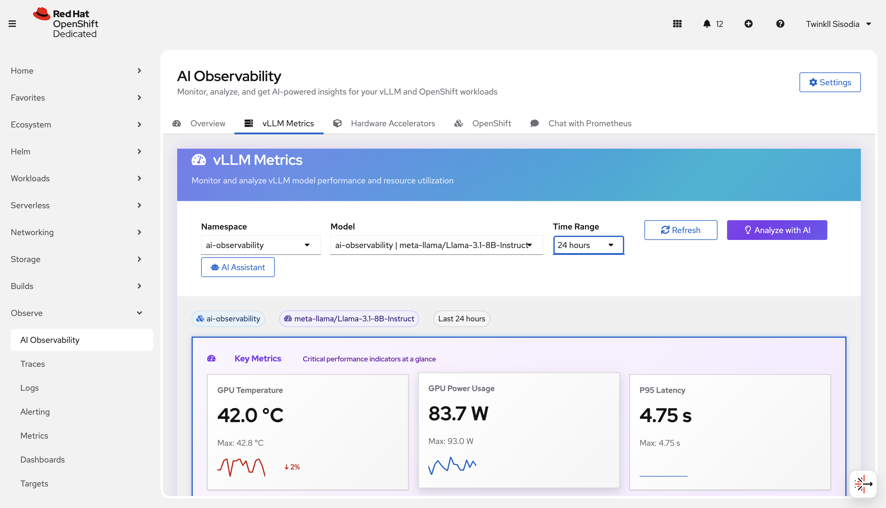

##### Hardware Accelerator

Use this page to review accelerator-related signals (for example GPU utilization/health when available).

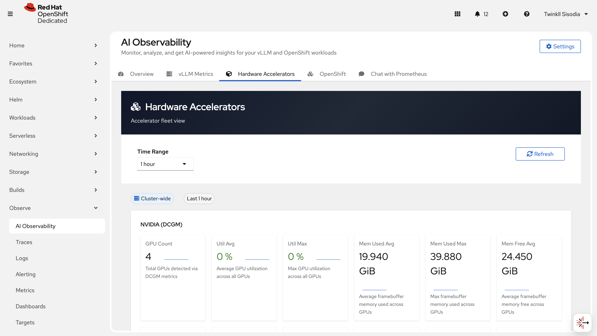

##### OpenShift metrics

Use this page to analyze cluster-wide and namespace-scoped OpenShift metrics.

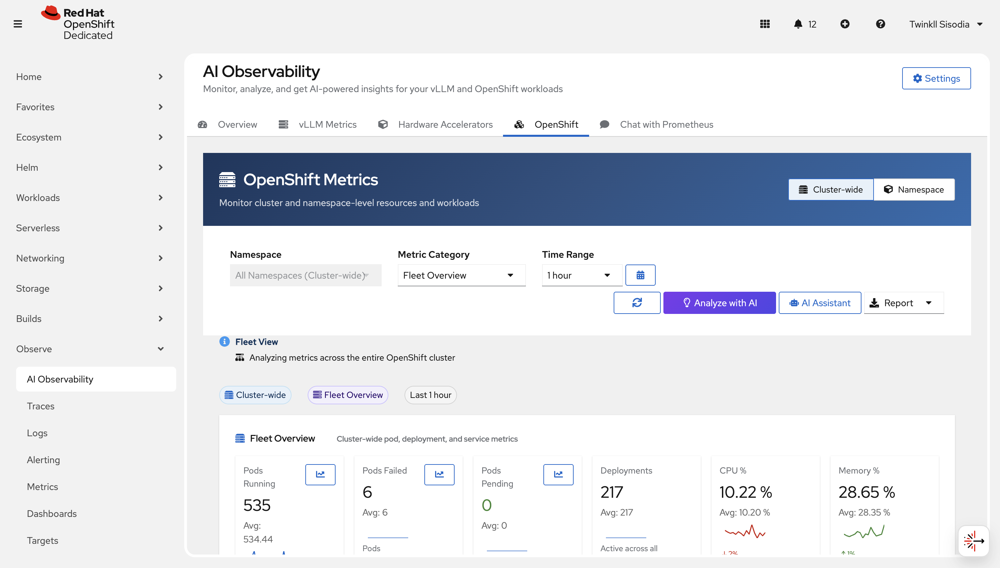

##### Chat with Prometheus

Ask questions in natural language and get a query + explanation back.

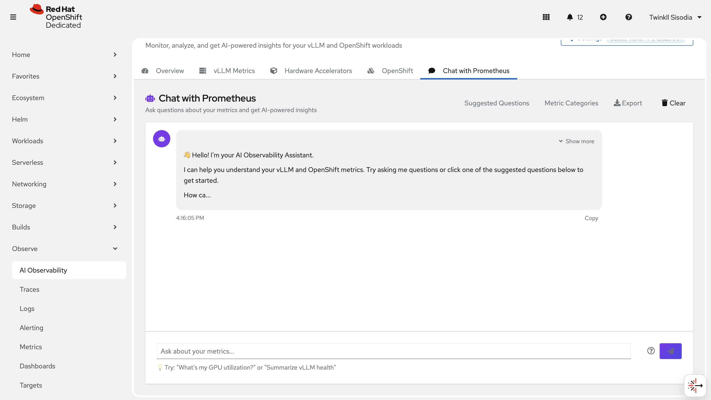

You can also navigate to suggested metrics and choose from the questions there -

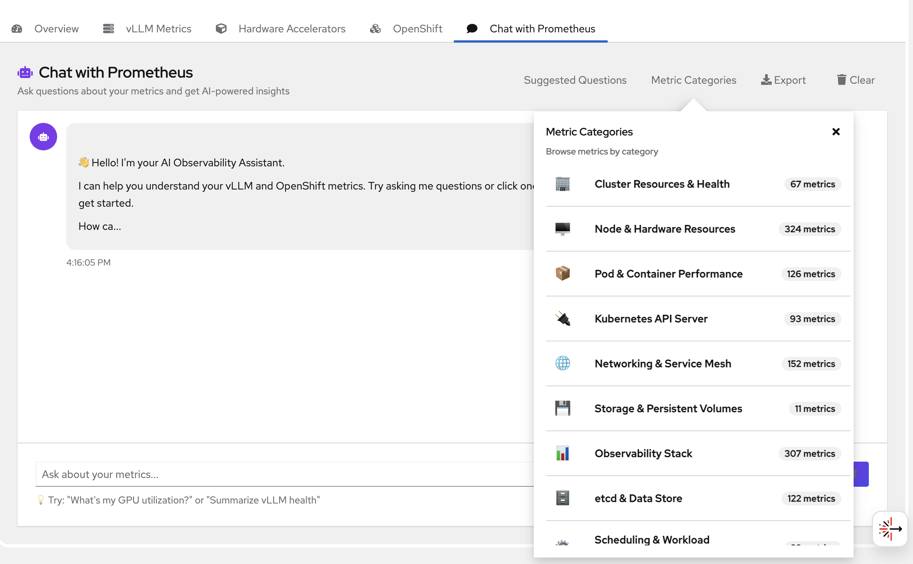

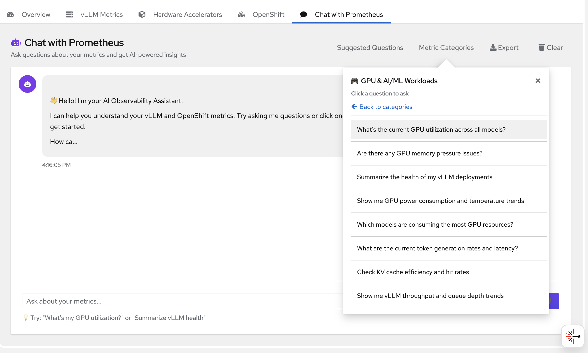

##### Reports

Export reports when needed (HTML/PDF/Markdown).

#### Configuration

#### Model as a Service (MaaS) Setup

Model as a Service provides access to Red Hat-hosted AI models with per-model API key configuration.

**Adding a MAAS Model:**

1. Navigate to **AI Observability → Settings → Add Model**
2. Select **Model as a Service (MaaS)** as the provider
3. Choose a model from the dropdown or enter a custom model ID
4. Provide your MAAS API key (unique per model)
5. (Optional) Override the default endpoint URL if needed
6. Click **Add Model**

**Key Features:**

- **Per-model API keys**: Each MAAS model requires its own API key, unlike other providers that use global keys
- **Custom endpoints**: Supports custom MAAS deployments for dev/staging/production environments
- **No global credentials**: MAAS models are configured individually in the "Add Model" tab, not in "API Keys"

**Environment Configuration:**

For production deployments with custom MAAS endpoints, set the environment variable in Helm values:

```yaml
env:
  MAAS_API_URL: "https://your-custom-maas.example.com/v1"
```

#### DEV Mode Workflow

By default, API keys and model settings entered in the UI are stored in Kubernetes Secrets and a ConfigMap in the application namespace, through the MCP server.

DEV mode instead keeps them in the browser's sessionStorage. It is intended for local development and quick model testing only. **Do not use DEV mode on shared clusters**: API keys held in the browser are exposed to anything running in that page, and they are lost when the tab closes.

**Enabling DEV Mode:**

```bash
make install NAMESPACE=your-namespace DEV_MODE=true
```

**How it works:**

- **API keys** are cached in browser `sessionStorage` (cleared on tab close)
- **Model configurations** are saved to browser `sessionStorage` (no ConfigMap updates)
- **Production mode** continues using Kubernetes Secrets/ConfigMaps for persistent storage

**DEV Mode Workflow:**

1. Install with `DEV_MODE=true`
2. Open the UI (Route `aiobs-react-ui`)
3. Navigate to **Settings → API Keys** or **Settings → Add Model**
4. Configure your models and API keys (saved to browser only)
5. Test your models immediately—no cluster resources modified

**Clearing DEV Mode Cache:**

A "Clear Cache" button is available in DEV mode to remove all cached credentials and model configurations from the browser.

**Production vs. DEV Mode:**

| Feature | Production (`DEV_MODE=false`) | DEV Mode (`DEV_MODE=true`) |
|---------|------------------------------|---------------------------|
| API Keys | Kubernetes Secrets | Browser sessionStorage |
| Model Configs | ConfigMap | Browser sessionStorage |
| Persistence | Permanent (cluster-wide) | Session only (tab close = reset) |
| Permissions | Requires RBAC | No cluster permissions needed |
| Intended for | All deployments (default) | Local development only |

#### Per-Model API Key Configuration

Different providers handle API keys differently:

**Global Provider Keys** (API Keys Tab)

Most providers use a single API key for all models:

- **OpenAI**: One key for all GPT models
- **Anthropic**: One key for all Claude models
- **Google**: One key for all Gemini models
- **Meta**: One key for all Llama models

Configure these in **Settings → API Keys**.

**Per-Model Keys** (Add Model Tab)

MAAS uses unique API keys per model:

- **Model as a Service (MaaS)**: Each model requires its own API key and endpoint

Configure these in **Settings → Add Model**.

**Custom Models:**

For custom OpenAI-compatible endpoints:

1. Go to **Settings → Add Model**
2. Select your provider (e.g., OpenAI, Meta, or Other)
3. Enter the model ID
4. Provide the custom endpoint URL
5. Enter the API key
6. Click **Add Model**

The system will inject the custom `api_url` when calling the model, enabling support for:

- Self-hosted models
- Custom model deployments
- Alternative OpenAI-compatible APIs

#### Observe → Traces / Observe → Logs (optional)

If enabled in your cluster, use:

- **Observe → Traces** to view traces
- **Observe → Logs** to query logs

#### Uninstall (Helm)

**Quick Uninstall** (application components only):

```bash
make uninstall NAMESPACE=your-namespace
```

This removes the React UI, MCP server, and RAG stack from your namespace (and the deprecated console plugin, if present).

**Full Uninstall** (including observability stack):

```bash
make uninstall NAMESPACE=your-namespace UNINSTALL_OBSERVABILITY=true
```

This removes everything including:
- Application components (React UI, MCP server, RAG)
- Observability infrastructure (S4, Tempo, Loki, OTEL, Korrel8r)
- Distributed Tracing Console Plugin (Observe → Traces menu)
- Logging Console Plugin (Observe → Logs menu)

> **⚠️ Warning:** The observability stack may be shared by other applications. Only use `UNINSTALL_OBSERVABILITY=true` if you're certain no other workloads depend on it.

---

### Access control

The UI shows cluster-wide metrics, logs, and traces. It reads them through the MCP server, which runs with cluster-wide read access. Signing in therefore requires more than an OpenShift account: by default, the UI's OAuth proxy only admits users who can list all namespaces (`oauth.openshiftSar` in `deploy/helm/react-ui-app/values.yaml`):

```yaml
oauth:
  openshiftSar: '{"resource":"namespaces","verb":"list"}'
```

Users without that permission are refused after signing in. To use a different check, put your own `oauth.openshiftSar` in a values file and upgrade the release:

```bash
helm upgrade aiobs-react-ui deploy/helm/react-ui-app -n your-namespace --reuse-values -f my-ui-values.yaml
```

Setting `openshiftSar: ""` admits any authenticated OpenShift user, who would then see data for the whole cluster. This is not recommended.

### MCP server route (disabled by default)

The UI reaches the MCP server through its in-cluster Service, so no Route is needed. Earlier versions also exposed the MCP server on a public Route for testing with MCP clients. That Route has **no authentication**, and the MCP server can read observability data for the whole cluster and save API keys.

The Route is now disabled by default. To enable it:

```bash
make install NAMESPACE=your-namespace MCP_SERVER_ROUTE_ENABLED=true
```

> **⚠️ Security:** If you enable the MCP server route, you are responsible for securing it, for example with an authenticating proxy or network restrictions. Without such measures, anyone who can reach the cluster's routes can use it. This is not safe on a publicly reachable cluster.

---

### Deprecated: Operator and OpenShift Console plugin

The AI Observability operator (OperatorHub) and the OpenShift Console plugin UI are **deprecated and no longer supported**. Install the quickstart with [`make install`](#install-via-helm), which deploys the standalone React UI.

- The operator images are no longer released. The Makefile `operator-*` targets fail with a deprecation message.
- `make install` no longer installs the console plugin, and `make install-console-plugin` fails with a deprecation message. The plugin is built with PatternFly 5 and renders unstyled on OpenShift 4.22 and later.
- The operator and plugin source code remain in the repository for reference ([docs/OPERATOR.md](docs/OPERATOR.md), [deploy/operator](deploy/operator)).

**Migrating from an operator installation:**

1. Uninstall the operator as described below.
2. Remove the console plugin entry that the operator leaves registered in the OpenShift Console:
   ```bash
   make uninstall-console-plugin NAMESPACE=ai-observability
   ```
3. Install with `make install NAMESPACE=<namespace>`. It replaces the Loki, Logging, Tempo, and OpenTelemetry operators that the operator installation added to `openshift-operators` with its own subscriptions.
4. If the Cluster Observability Operator was already installed in its own namespace, the operator installation may have left a second, **Failed** copy in `openshift-operators` (`InterOperatorGroupOwnerConflict`). Remove that copy:
   ```bash
   oc get csv -n openshift-operators | grep cluster-observability-operator
   oc delete subscriptions.operators.coreos.com,csv -n openshift-operators \
     -l operators.coreos.com/cluster-observability-operator.openshift-operators
   ```
   Only do this if the copy in `openshift-operators` is the Failed one.

Do not run both installation methods on the same cluster.

#### Uninstall (Operator)

For existing operator installations:

**Quick Uninstall:**

1. **Delete the CR:**
   ```bash
   oc delete aiobservabilitysummarizer cluster-ai-observability -n ai-observability
   ```

2. **Uninstall Operator:**
   ```bash
   oc delete subscription aiobs-operator -n openshift-operators
   oc delete csv -l operators.coreos.com/aiobs-operator.openshift-operators -n openshift-operators
   ```

3. **Delete CatalogSource:**
   ```bash
   oc delete catalogsource aiobs-operator-catalog -n openshift-marketplace
   ```

4. **Optional - Uninstall dependency operators** (if no longer needed):
   ```bash
   # Check if other apps use these operators before removing
   oc get csv -n openshift-operators | grep -E "cluster-observability|tempo|loki|logging|opentelemetry"
   ```

**📚 Complete Uninstall Guide:** See [docs/OPERATOR.md](docs/OPERATOR.md#uninstallation) for detailed cleanup verification steps.

---

## References

- Uses [Prometheus](https://prometheus.io/) and [Thanos](https://thanos.io/)
- Uses [Tempo](https://grafana.com/oss/tempo/) for traces
- Uses [Loki](https://grafana.com/oss/loki/) for logs
- Uses [vLLM](https://github.com/vllm-project/vllm) for model serving (when applicable)
- Integrates with [OpenTelemetry](https://opentelemetry.io/) for distributed tracing and observability

## Tags

- **Business challenge:** Adopt and scale AI
- **Product:** OpenShift AI
- **Use case:** AI Operations, Observability, Monitoring
