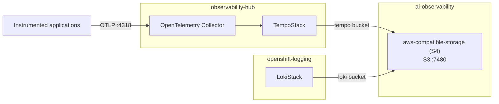

# Observability Stack Overview

## Overview

The OpenShift AI Observability Summarizer includes a comprehensive observability stack that
provides distributed tracing capabilities for monitoring AI applications and OpenShift workloads.

This document provides a complete overview of the observability components, their relationships, and how they work together.

## Architecture



Tempo and Loki use in-cluster S3 endpoints and namespace-local credential Secrets. The S4 Web UI Route is enabled; its S3 API Route is disabled.

## Components

- **aws-compatible-storage (S4)**: S3-compatible object storage for traces/logs, hosted in `ai-observability`.
- **TempoStack**: Trace storage and query backend.
- **OpenTelemetry Collector**: Trace ingestion and processing.
- **Auto-instrumentation**: Injects tracing libraries into app pods.

## Data Flow

1. **Application Startup**:

   - Python applications start with OpenTelemetry init containers
   - Init containers inject tracing libraries and environment variables
   - Applications begin generating traces automatically

2. **Trace Generation**:

   - Applications generate traces for HTTP requests, database calls, etc.
   - Traces include spans with timing, metadata, and context information
   - Traces are sent to OpenTelemetry Collector via OTLP protocol

3. **Trace Processing**:

   - OpenTelemetry Collector receives traces on port 4318
   - Collector processes and enriches trace data
   - Collector forwards traces to Tempo gateway

4. **Trace Storage**:

   - Tempo gateway receives traces and distributes them
   - Tempo ingester stores traces in the S4 `tempo` bucket over port 7480
   - Tempo compactor optimizes storage and removes old traces

5. **Trace Querying**:
   - Tempo querier provides trace search and retrieval
   - Tempo query frontend optimizes complex queries
   - Traces can be viewed in OpenShift console or Grafana

## Quick Start

### Installation

Install the complete observability stack (recommended):

```bash
# Install complete stack with tracing enabled
make install-observability-stack NAMESPACE=your-namespace
```

Or install individual components:

```bash
# Install S4 storage in ai-observability and create the tempo/loki buckets
make install-s4

# Install TempoStack and OpenTelemetry Collector
make install-observability

# Enable auto-instrumentation for applications
make setup-tracing NAMESPACE=your-namespace
```

### Verification

Check installation status:

```bash
# Check all observability components
oc get pods -n observability-hub

# Check instrumentation in application namespace
oc get instrumentation -n your-namespace

# Verify namespace has instrumentation annotation
oc get namespace your-namespace -o yaml | grep instrumentation

# Check application pods have init containers
oc get pod <pod-name> -n your-namespace -o yaml | grep -A 5 "initContainers:"
```

### View Traces

Access traces through:

1. **OpenShift Console**: Navigate to **Observe > Traces**
2. **Grafana** (if available): Configure Tempo as data source

### Common Operations

```bash
# Check OpenTelemetry Collector logs
oc logs -n observability-hub deployment/otel-collector-collector --tail=20

# Check Tempo gateway logs
oc logs -n observability-hub deployment/tempo-tempostack-gateway --tail=20

# Check S4 pod and PVC status
oc get pods,pvc -n ai-observability | grep s4

# Restart instrumented application
oc rollout restart deployment/<deployment-name> -n your-namespace
```

## Troubleshooting

For detailed troubleshooting steps, common issues, and diagnostic commands, see:

- [TROUBLESHOOTING.md](TROUBLESHOOTING.md) - Comprehensive troubleshooting guide

## Further Documentation

For installation, configuration, troubleshooting, and GPU-specific details, see:

- `README.md` - Main project documentation
- `docs/DEV_GUIDE.md` - Development workflows and architecture
- `docs/INTEL_GAUDI_METRICS.md` - Intel Gaudi accelerator metrics
- `deploy/helm/observability/tempo/README.md` - Tempo configuration
- `deploy/helm/observability/otel-collector/README.md` - OpenTelemetry Collector configuration
